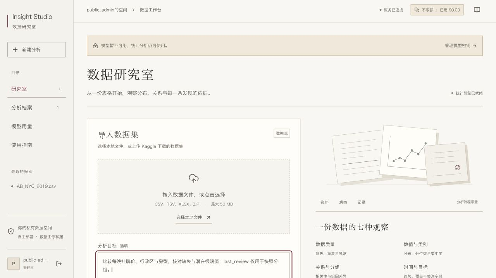
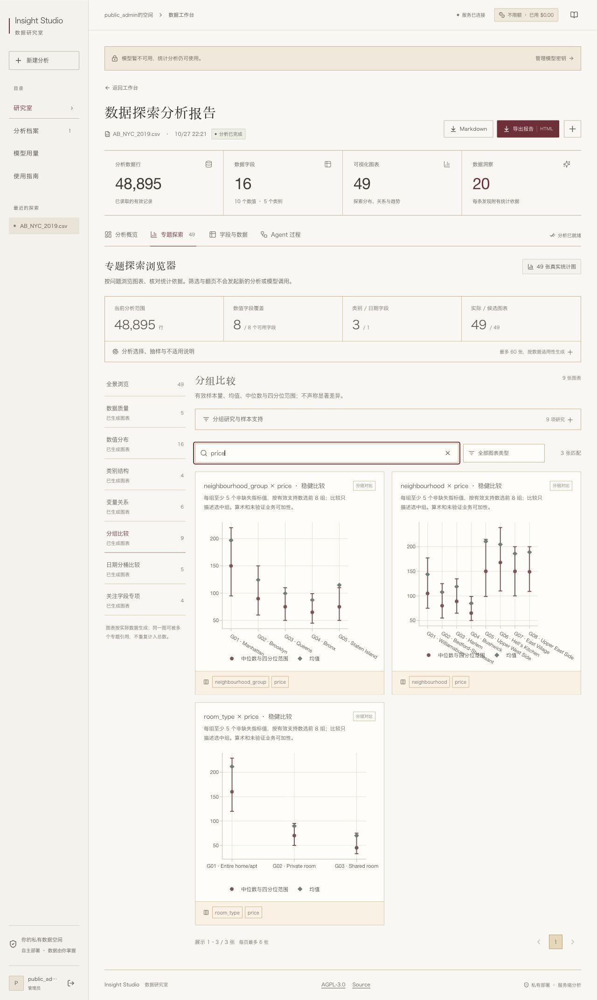
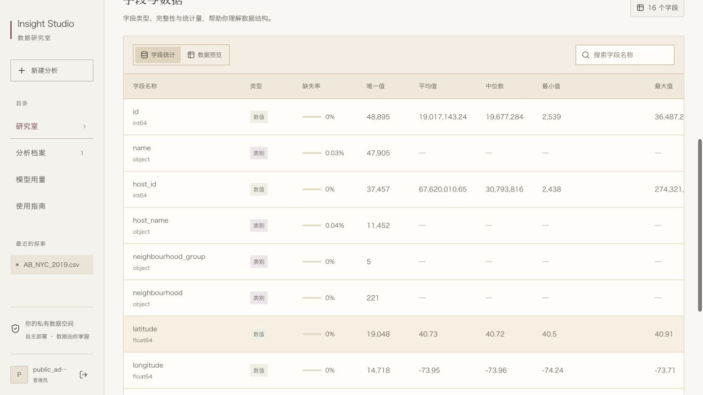
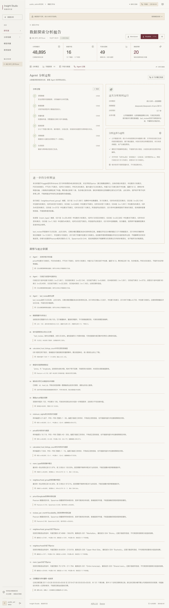
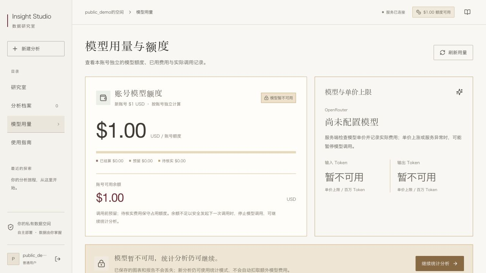
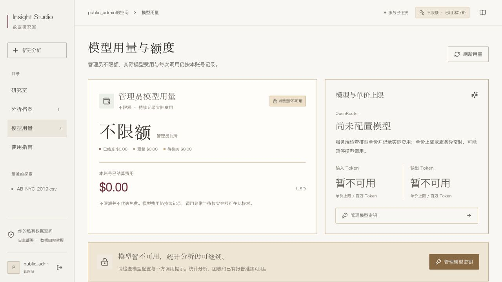
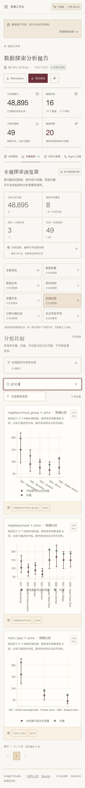
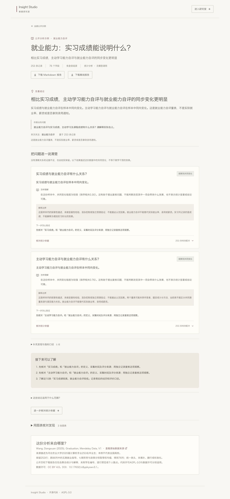
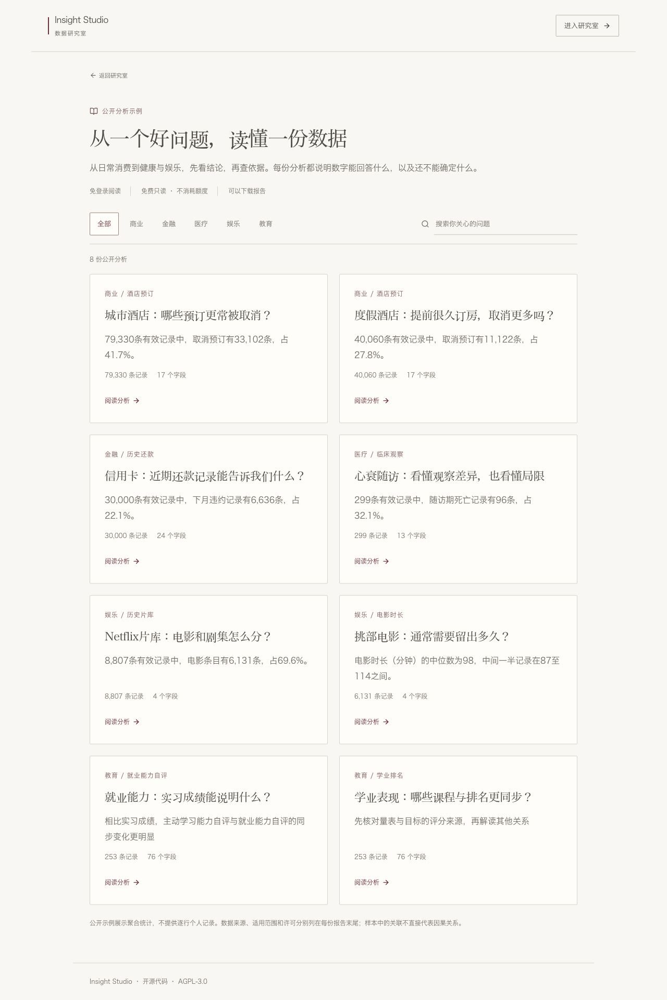

# Insight Studio

**上传一份表格，先看懂主要结论，再展开数字依据与图表。**

A self-hosted data analysis workspace with a React frontend, a Python analysis pipeline, optional model-assisted explanations, and per-account usage accounting.

Insight Studio 将文件读取、数据概览、质量检查、图表生成、洞察整理和报告导出分为六步。统计分析可以独立运行；配置 OpenRouter 后，用户可以选择让模型解释经过筛选的汇总证据。模型解读与统计证据分开呈现，方便核对。

## 能做什么

- 面向教育数据和非研发读者，先逐项回答问题，再解释含义、边界与下一步验证。弱关联和证据不足也会保留，无模型也能生成附数字依据的结论。见[解释型分析与毕业生案例](docs/explanatory-analysis.md)。
- 内置免登录的公开分析示例：进入网站的 `/?view=examples`，按领域或关键词浏览 **8个案例**。新增酒店预订、信用卡还款、心衰随访、Netflix片库与片长分析，保留2个毕业生案例；展开数字依据并下载报告。仅捆绑聚合统计，浏览和下载不调用模型。来源、许可与复现见[跨领域案例](docs/cross-domain-examples.md)和[毕业生案例](docs/explanatory-analysis.md#graduation案例)。
- 数值目标按问题回答排序关联或分组均值／中位数；类别目标可比较各组构成。来源明确事件编码时，显示事件数／有效分母、组内比例和百分点差。小组保留计数并提示不足；明确标记的事后字段不进入重点解释或模型证据。
- 上传后从实际字段选择关注指标，使用自动识别的问题；毕业生表可区分GPA排名、实习成绩和就业能力自评。
- 上传 CSV、TSV、XLSX，或从 ZIP 中选择一份表格；每次分析一个数据表。
- 浏览质量、分布、类别、变量关系、分组比较、日期和关注字段七个专题，最多生成 60 张图。
- 查看分位数、偏度、超额峰度、潜在异常值、Pearson/Spearman 相关及分组样本量。
- 按专题、字段和图表类型筛选，按页浏览；下载 Markdown 或可离线打开的 HTML 报告。
- 注册与登录账号，隔离上传、分析历史、下载和用量。普通账号共享服务端模型配置，各有 **1 USD 终身应用额度**；管理员无应用内累计金额上限。
- 使用纸白配色、克制的排版和响应式布局，兼顾桌面与手机。

系统提供描述性 EDA。它不自动训练模型、不执行模型生成的代码，也不把相关系数当作因果证据。模型文字可能出错；已知风险检查只能拦截部分无依据断言，不能替代业务复核。

教育数据中，GPA排名按“名次越小越靠前”解释，实习列按成绩解释，就业能力自评与实际就业结果分别说明。量表和排名高度同步时，先提示核对采集与计分来源；课程参与排名计算时，不把两者的相关包装成教学干预效果。完整图表和方法保留为可展开的依据。

## 界面预览

以下截图来自重新初始化的本地演示实例，使用演示账号。Kaggle 案例使用真实公开的纽约 Airbnb 历史快照；模型文字由已有输出离线重放，**截图过程没有发起新的付费推理**。画面中的演示用量不代表公开在线服务或真实账单。数据来源与解释边界见[案例说明](docs/real-data-provenance.md)。

| 登录 | 注册 |
| --- | --- |
|  |  |

| 导入入口与目标设置 | Kaggle 数据概览 |
| --- | --- |
|  |  |

| 分组比较 | 字段画像 |
| --- | --- |
|  |  |

| Agent 过程 | 普通账号用量 |
| --- | --- |
|  |  |

| 管理员用量 | 手机看板 |
| --- | --- |
|  |  |

| 教育数据的结论与解释 | 公开毕业生分析示例 |
| --- | --- |
|  |  |

教育案例截图来自本地预处理的Graduation公开数据，未调用付费模型；来源、许可和测量局限见[案例说明](docs/explanatory-analysis.md#graduation案例)。

新增商业、金融、医疗、娱乐示例，使用固定版本的真实Kaggle数据完整生成，无付费模型调用。下面是本地匿名页面；酒店的完整结论、分组表与已展开图表另见[详细截图](docs/screenshots/14-hotel-example.jpg)。



## 本地启动

需要 Python 3.12 和 Node.js 24。前端依赖按 `package-lock.json` 安装，Python 依赖按锁定版本安装。

```bash
python3.12 -m venv .venv
.venv/bin/python -m pip install --find-links deploy/wheels -r backend/requirements-dev.txt
cp .env.example .env
```

编辑 `.env`：设置初始 `ADMIN_PASSWORD` 和至少 32 字符的随机 `SESSION_SECRET`；本地开发将 `COOKIE_SECURE=false`、`DATA_DIR=./data`、`STATIC_DIR=`。暂不使用模型时，保持 `LLM_API_KEY` 为空即可。真实密码和密钥不要提交到仓库。

```bash
.venv/bin/python -m uvicorn app.main:app --app-dir backend --env-file .env --host 127.0.0.1 --port 8108
```

另开终端启动前端：

```bash
cd frontend
npm ci
npm run dev -- --host 127.0.0.1
```

访问 `http://localhost:5173`，使用 `.env` 配置的初始管理员登录，或自行注册普通账号。可先运行内置的合成零售示例；它与真实 Kaggle 案例有明确区分。完整配置、构建与排错见[开发指南](docs/development.md)。

## 分析范围

单文件上限 50 MiB，最多 80 列。超过 100,000 行时，只分析文件顺序中的前 100,000 行并明确标注，无法据此声称是随机样本或全表结论。目标解释扫描全部合格数值字段；图表探索按问题和目标关系选择最多 10 个数值字段、5 个类别字段及 1 个日期字段；全字段基础画像仍可查看。图表和模型证据都有独立数量限制，详见 [EDA 设计](docs/eda-design.md)。

逐项回答按问题中识别出的字段顺序，最多展示12项；未回答数量会明确标注。数值关系使用成对完整记录的Spearman排序相关；类别或事件比较使用同时有效的记录，各组至少20条才参与差异比较，仍保留小组计数。连续分组字段按四分位划分，并披露真实分界。展示门槛不是显著性或因果判断。未知0/1编码只报告原始类别，不能擅自当作违约、死亡或通过；公开案例的事件含义来自核验过的来源元数据。干预、非线性、删失和个体预测仍需额外方法与验证。

模型默认示例配置为 DeepSeek V4 Pro 的指定 OpenRouter 端点。模型、提供商和单价上限由服务端配置；价格、能力或隐私条件无法核验时停止该次模型调用。只有管理员可更换共享后端密钥。普通账号额度跨重启、删除报告和更换密钥持续累计；模型不可用或额度不足时仍可运行统计分析。见[账号与额度](docs/accounts-and-quotas.md)及[模型与计费](docs/model-and-budget.md)。

## 自托管与文档

项目支持普通 Linux 主机上的 systemd + Caddy 部署，也提供 Docker Compose。部署脚本需要显式指定自己的服务器和域名；仓库包含程序、配置模板和公开数据复现说明，请部署自己的实例。

| 文档 | 内容 |
| --- | --- |
| [用户指南](docs/user-guide.md) | 上传、探索、导出与重新分析 |
| [系统架构](docs/architecture.md) | 前后端、工作线程、持久化与隔离 |
| [API 契约](docs/api-contract.md) | 会话、任务、EDA 与用量字段 |
| [账号与额度](docs/accounts-and-quotas.md) | 角色、数据归属与普通账号额度 |
| [EDA 设计](docs/eda-design.md) | 统计口径、选择规则与边界 |
| [Agent 设计](docs/agent-design.md) | 六步流程、模型输入与结果审查 |
| [模型与计费](docs/model-and-budget.md) | 提供商限制、预留、结算与异常处理 |
| [开发指南](docs/development.md) | 本地运行、配置、构建与代码位置 |
| [部署指南](docs/deployment.md) | 域名 HTTPS、自托管、备份与回滚 |
| [验证指南](docs/testing.md) | 测试、免费冒烟与可选付费验证 |
| [安全指南](docs/security-guide.md) | 密钥、公开注册、数据与报告隐私 |
| [Kaggle 案例](docs/real-data-provenance.md) | 来源、许可标记、汇总结果与解释局限 |
| [跨领域公开案例](docs/cross-domain-examples.md) | 四份真实Kaggle来源、六个新增案例、预处理与复现 |
| [视觉设计](docs/design-system.md) | 纸面配色、布局与无障碍交互 |
| [公开发布记录](docs/public-release.md) | 脱敏范围、截图与验证边界 |

## 许可证与贡献

代码按 **AGPL-3.0-only** 分发，完整条款见 [LICENSE](LICENSE)。第三方依赖与案例数据适用各自许可，见 [THIRD_PARTY_NOTICES](THIRD_PARTY_NOTICES.md)。安全问题请按 [SECURITY.md](SECURITY.md) 中的方式报告，不要在公开 Issue 中粘贴密钥或私人数据。

欢迎提交可复现的错误报告与改进。请在提交前运行相关测试，使用脱敏的最小数据说明问题，并核对 [API 契约](docs/api-contract.md)及分析口径是否需要同步更新。源代码仓库：[GitHub](https://github.com/lingxiao001/insight-studio)。
