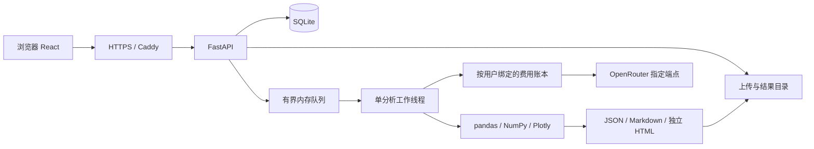

# 系统架构

Insight Studio 将可复算的统计分析与可选模型解读分开。前端呈现保存结果；后端负责安全读取、计算、报告和账号计费。模型只接收有界汇总，不参与代码执行或文件读取。

## 请求与任务

上传和创建任务分两次请求。服务端先检查文件、列出可选表格，再记录所选成员、目标、关注字段与 `use_llm`。工作线程依次执行读取、画像、质量、图表、洞察和报告六步，前端轮询进度。每次处理一张表，不自动拼接多个 ZIP 成员或 XLSX 工作表。

一个进程运行一个工作线程，最多一项运行、四项排队。队列在内存中，任务状态在 SQLite 中。服务重启会将未完成任务标记失败，用户可以显式重新分析；不会自动恢复付费推理。多进程或横向扩容需要外置队列和锁协调，当前实现不支持直接增加 workers。

## 数据与权限

`users` 保存密码哈希和角色，`uploads`、`jobs` 保存 `user_id`。任务列表、单项读取、下载、重试和删除均按已登录账号过滤；其他账号的资源 ID 返回 404。管理员可以配置共享模型密钥，但普通报告接口仍只访问自己的报告。

SQLite 及上传、结果文件保存在 `DATA_DIR`。报告以保存结果为准，打开旧报告不会触发重新分析。兼容旧版结果中缺失的 EDA 字段。删除任务只清理已无其他任务引用的源文件，不删除计费记录。

## 模型与费用

任务创建时持久化的拥有者决定计费身份，工作线程使用 `ledger.for_user(user_id)`。费用按用户跨密钥周期累计。普通账号的终身应用额度为 1 USD；管理员不受累计金额上限限制，仍受配置、单次输出、价格、隐私和账单异常检查约束。

模型调用前，后端只读核验密钥及候选端点，原子预留最坏费用，然后最多发送一次推理。成功费用按提供商返回的 `usage.cost` 结算；内容不合格也可能已计费。超时或缺少可靠成本时保留预留，不自动重试。完整状态机见[计费设计](model-and-budget.md)。

## 部署边界

生产推荐 Linux + systemd + Caddy：Caddy 管理域名 HTTPS，FastAPI 只监听 `127.0.0.1:8108`，应用使用非 root 用户。前端构建为静态文件，由应用提供；开发时使用 Vite 代理。Docker Compose 提供同样的单应用进程与持久卷，HTTPS 由宿主反向代理处理。

备份需要一致地覆盖 SQLite、上传、结果、模型密钥目录和服务端环境配置。私有备份不属于源代码，不进入 Git。见[部署指南](deployment.md)与[安全指南](security-guide.md)。
