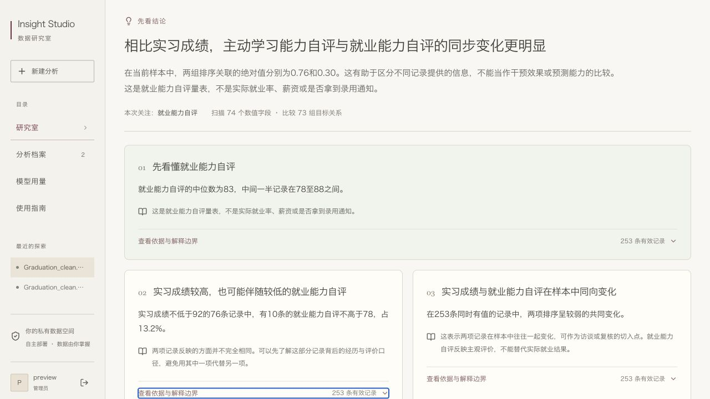
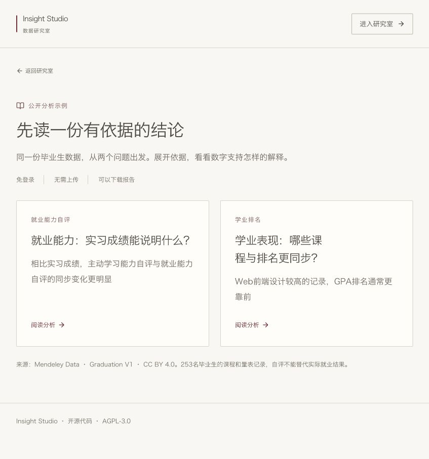

# 面向非研发读者的结论与解释

上传后，先选择关注指标，或使用识别出的常见问题。指标从表头读取，不需要手输列名。字段识别只在本地运行，不创建分析任务、不调用模型。

结果默认打开“结论与解释”：直接回答问题，再列出最多五条发现。每条包含事实、日常语言解释和可展开的数字依据／边界。图表、质量检查和方法仍可查看；Markdown与离线HTML也先展示结论。旧报告继续显示原概览。



截图来自本地演示账号和下述公开Graduation预处理数据，未调用付费模型，不代表在线部署或实际账单。

## 解释规则

- 自动关注问题中明确提及的字段；毕业生表识别GPA排名、就业能力自评，通用表识别销售额、利润等。用户可换选。不能识别时描述类别构成，不编造结果变量。
- 目标关系扫描全部合格数值列，不受十个图表字段上限限制。每对在完整记录内计算Spearman排序相关。展示关系至少20对值、相关绝对值至少0.20；0.40／0.70为中等／较强的描述口径。这些门槛不表示统计显著或因果。
- 先回答问题中提到的字段，再补充关联程度较高的关系。图表的十列选择也使用此顺序；仍最多60图。
- 分组解释最多一项，每个保留组至少20个有效值、最多8类；展示观察差异达到目标标准差0.20的候选，交代遗漏小组。属于探索筛选，未控制混杂、未做显著性检验。
- 与量表相关的排序关系绝对值达到0.95时，提示信息高度重合、需核对采集和评分来源；不直接背书量表有效，也不据此断言造假。
- 支持不足时明确说明，保留可核对的分布或类别事实，不为填满卡片制造结论。
- 问题提及的非排名数值字段可生成一项交叉观察：至少40对有效值、两列至少4个不同值；在配对样本中按解释字段Q3、目标Q1划分，包含等于边界的值。高值组至少10条、交叉组至少5条时才展示，分母为该高值组，不是全表。这是样本分位划分，不是合格标准。

`brief.coverage`记录扫描字段、计算关系与分析行数。首页和导出使用同一份brief，不在浏览器重新计算。可选模型只接收有界数字证据，原始行和类别标签仍不外传；规则结论不会被模型返回替换。

## Graduation案例



网站内置两个免登录的公开分析示例：`/?view=examples`为目录，`/?example=graduation-employability`和`/?example=graduation-academic`分别阅读就业能力与学业排名。登录页、研究室和侧栏均提供入口。示例与私有任务分开，只读浏览与下载不创建任务、不调用模型、不消耗额度。

仓库中的`backend/app/example_data/`仅保留聚合快照：结论、分箱计数、排序关联与交叉组计数。不附学生编号、逐行数据、原始散点或私有任务标识。公开HTML和Markdown也由同一快照导出。数据来源、CC BY 4.0和预处理说明随页面与报告保留；它们不改变程序的AGPL许可。

来源：Wang, Dongxuan (2025), *Graduation*, Mendeley Data, V1，[10.17632/c8ypkyswv3.1](https://data.mendeley.com/datasets/c8ypkyswv3/1)，CC BY 4.0。来源描述为河北农业大学2020届计算机专业253名毕业生的课程与量表记录；这不是独立的真实性审计。

案例使用预处理CSV：原始86列中，五期就业指导取等权均值、七期形势与政策取等权均值，12列变2列，结果253行、76列；表头转snake_case，未删除学生、填补或标准化分数。原始86列工作簿超过产品80列限制且有两行表头，不能直接当作预处理文件。

```bash
PYTHONPATH=backend .venv/bin/python scripts/graduation-case.py \
  --input /path/to/Graduation_clean.csv --output-dir data/graduation-case
```

脚本生成学业、就业能力两个独立报告，不调用模型、不将数据写入仓库。也可在界面上传同一CSV，选择自动识别的问题。

维护者可从相同预处理文件重建公开聚合快照（会更新仓库内的两个示例JSON）：

```bash
PYTHONPATH=backend .venv/bin/python scripts/build-graduation-examples.py \
  --input /path/to/Graduation_clean.csv
```

公开API只有固定示例目录、详情及报告的GET请求免登录；其他账号数据、上传、任务和模型接口仍要求登录。示例内容随应用代码部署，不依赖本地数据目录或某个演示账号。

- `gpa_rank`是名次，越小越靠前，不是GPA数值；课程可能参与排名计算，关联不能视为独立影响。
- `employment_ability_scale`是自评，不是实际就业状态、就业率、薪资或录用。
- `internship`是实习成绩，不是次数、时长或有无实习。
- 四／六级0/1指标没有编码字典时保留原编码，不自动称为通过率。
- 量表与排名的排序高度对应是值得核对的测量现象，不能解释为能力的因果作用。

## 验证

`test_explanations.py`覆盖宽表尾部字段、排名方向、成对缺失、支持不足、字段建议、导出转义、旧报告。`test_api.py`验证字段识别账号隔离与无任务副作用。实际案例复现用于核对数值与展示，不能替代独立问卷或就业结果。
